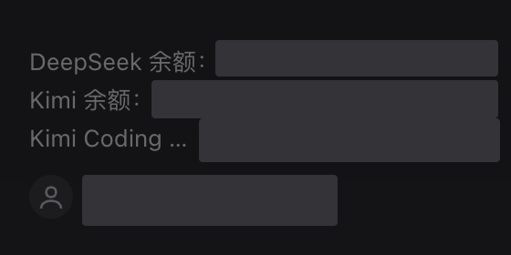
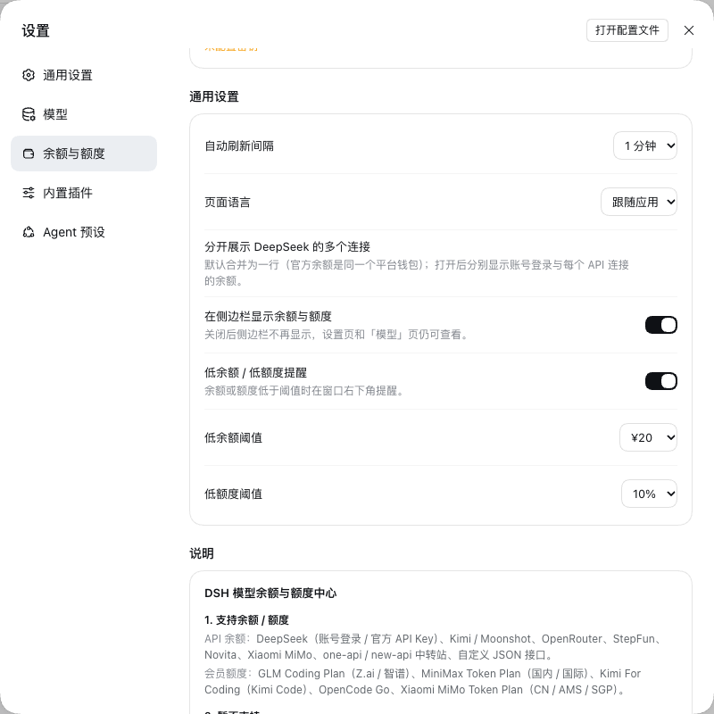
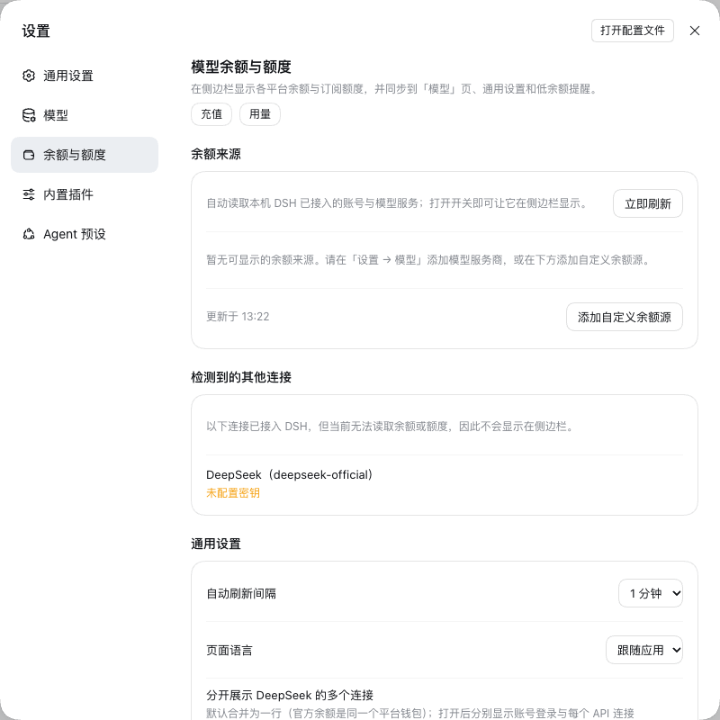

<div align="center">
  
  <h1>DSH Balance &amp; Quota Center · 余额与额度</h1>
  <p><strong>Manage model provider balances and subscription quotas in the DSH sidebar.</strong></p>
  <p>
    <strong><a href="https://github.com/dan-cube/dsh-balance-center/releases/download/v1.1.0/dsh-balance-center-1.1.0.tgz">Download v1.1.0 (.tgz)</a></strong> ·
    <a href="#install">Installation guide</a> ·
    <a href="#supported-sources-and-how-to-enable-them">Supported platforms</a>
  </p>
  <p>
    <a href="README.md">中文</a> · English ·
    <a href="#settings-page">Settings</a> ·
    <a href="#privacy-and-security">Privacy</a>
  </p>
  <p>
    <a href="https://dsh-plugin.org/plugins/dan-cube/dsh-balance-center"></a>
    <a href="https://github.com/dan-cube/dsh-balance-center/releases"></a>
    <a href="https://github.com/dan-cube/dsh-balance-center/blob/main/LICENSE"></a>
    
    <a href="https://github.com/dan-cube/dsh-balance-center/stargazers"></a>
  </p>
  <p><code>dsh plugin --profile desktop add 'git+https://github.com/dan-cube/dsh-balance-center.git#v1.1.0'</code></p>
</div>

**Latest release · v1.1.0 · 2026-11-17** — adds Xiaomi MiMo and OpenCode Go, DSH 0.2.2 integration, low-balance alerts, and Xiaomi authenticated-endpoint validation. [Release notes](https://github.com/dan-cube/dsh-balance-center/releases/tag/v1.1.0) · [Version history](CHANGELOG.md)

View balances and subscription quotas across model providers inside DSH, with low-balance alerts and reset times close at hand.

Shows the balances of the model API access you configured in the Harness — and,
for subscription plans, their remaining quota — as compact rows directly above
the sidebar account row. Rows are named `<platform> 余额` / `<platform> 额度` (or
`<platform>` in English) — there is no “member balance” wording. Everything is
managed on its own native settings page, and only sources the Harness can
actually read are listed.

## At a glance

| | |
|---|---|
| Balances | DeepSeek (member account or API key), Kimi, OpenRouter, StepFun, Novita, Xiaomi MiMo, one-api / new-api relays, custom JSON endpoints |
| Subscription quotas | GLM Coding Plan, MiniMax Token Plan, Kimi For Coding, OpenCode Go, Xiaomi MiMo Token Plan |
| Where it shows | Sidebar rows, its own settings page, Models settings cards and footer, General settings toggle |
| Alerts and links | Low-balance / low-quota overlay alerts with thresholds, top-up and usage links |
| Language | Chinese / English, switchable per row |

## Screenshots

Screenshots from the running DSH app. The sidebar balance values are masked.


| Sidebar rows | Settings and alert thresholds |
|---|---|
|  |  |

### Settings walkthrough



Recorded in a real, isolated DSH 0.2.2-rc.3 Web profile with no model credentials configured. It demonstrates settings operations. The sidebar image above is from the account-connected app with private values masked.

[Full WebM recording](assets/settings-demo.webm) · [About, privacy and version](docs/screenshots/settings.png)


Each source is one row in the form `Name：currencySymbol+amount`, left aligned,
with the amount emphasised. Currency comes from the provider response (`¥`, `$`,
or `12,345 Token`). Positive amounts are truncated to cents, a positive sub-cent
balance shows `<¥0.01`, and negative debt is rounded with its sign kept.

## Features

- **Native placement** — a non-interactive rows block in the sidebar footer slot
  `sidebar.footer.action`, tightly placed above the account row, hidden in the
  collapsed rail. No shipped UI is replaced.
- **Automatic discovery** — reads the model providers configured in the Harness
  (`llm` service + settings + credentials) and only lists sources that can
  actually be read. Add a provider in **Settings → Models**, open the plugin
  settings page, and it appears.
- **Balances and subscription quotas** — balances render as amounts; subscription
  plans (GLM Coding Plan, MiniMax Token Plan, Kimi For Coding) render as
  “X% left · reset in …”.
- **Unreadable connections are explained** — connections without a readable
  interface, key, subscription plan or sign-in are listed under **Other detected
  connections** with the reason; rejected keys and network failures stay in the
  **sources** list with an inline reason instead of silently disappearing.
- **One DeepSeek row by default** — official DeepSeek connections are grouped
  into a single `DeepSeek 余额` row to reduce duplicate readings for one account.
  The plugin displays one readable connection, without adding balances together.
  Enable **Settings → Split DeepSeek connections** when using different accounts;
  grouping does not verify that the connections belong to the same account.
- **Unified naming** — every row uses `<platform> 余额` (`<platform>` in
  English); member-specific wording such as “会员余额” is intentionally never
  used, and future providers follow the same rule.
- **Per-source controls** — show/hide, reorder, and a label language (`auto`,
  `中文`, `EN`) per row.
- **Refresh** — interval 15 s / 30 s / 1 / 2 / 5 minutes / manual, plus refresh
  on window focus, page visibility, credential changes, and every time the
  settings page is opened.
- **Custom sources** — any JSON balance endpoint: URL, `Authorization: Bearer`,
  custom header, or no authentication, a JSON field path, and CNY/USD/Token.
  A custom key is entered in the settings page, saved through the Harness credential
  service, and resolved by the Host for balance queries. Test connection reads only
  the saved credential — an unsaved key is never sent; authenticated custom
  endpoints must use HTTPS (localhost excepted).
- **Bilingual** — all page copy and labels ship in Chinese and English.
- **Models-page integration** — every provider card shows a balance/quota summary,
  and the Models page gets a footer summary with its own refresh.
- **General-settings shortcut** — a General settings row toggles the sidebar rows and
  configures low-balance/low-quota alerts.
- **Top-up links** — when the DSH account is signed in, the settings page links to
  top-up and usage pages.
- **DSH 0.2.2 ready** — verified on `0.2.2-rc.3`; uses the newer Models-card,
  General-settings, navigation-icon and overlay extension points.
- **Theme-native** — only `--dsw-alias-*` theme tokens; works in light and dark.

## Language

- **Follows the app by default** — the plugin uses the DSH app language (Chinese app → Chinese UI, English app → English UI).
- **Change it manually** — **Settings → Balances & quotas → Page language**: follow app / 中文 / English.
- **Per-source label language** — the dropdown on each source row supports auto / 中文 / EN; it only changes that row's label, never the amounts.
- The plugin-manager title/description, every settings-page string, error and status messages, and this README ship in both Chinese and English.

## Supported sources and how to enable them

**Balances** are top-up account amounts; **quotas** are subscription plan windows
(5-hour / weekly). They are different things and render as different rows — this
is a balance center and a quota center.

### Balance sources

| Source | Credential | Where to get it | Display |
|---|---|---|---|
| DeepSeek (membership / account login) | DSH sign-in | DSH **Settings → Account & balance** | `DeepSeek 余额：¥xx` |
| DeepSeek (official API key) | API key | DeepSeek platform, `platform.deepseek.com` | grouped with the account row |
| Kimi / Moonshot (open platform) | API key | `platform.moonshot.cn` / `platform.moonshot.ai` | `Kimi 余额：¥xx` / `$xx` |
| OpenRouter | management or inference key | `openrouter.ai` → Keys | account credits, or that key’s remaining limit |
| StepFun | API key | `platform.stepfun.com` | `StepFun 余额：¥xx` |
| Novita AI | API key | `novita.ai` → API keys | `Novita 余额：$xx` |
| Xiaomi MiMo (pay-as-you-go) | API key (`sk-`) | `platform.xiaomimimo.com` → API key | `Xiaomi MiMo 余额：¥xx` (official HTTPS endpoint only) |
| one-api / new-api relay | API key | your relay console | balance or quota |
| Custom JSON source | any (or none) | your own JSON endpoint | configured field + currency |

### Subscription quota sources

| Source | Credential | Where to get it | Display |
|---|---|---|---|
| GLM Coding Plan (Z.ai / BigModel) | Coding Plan API key | `z.ai` / `bigmodel.cn` console after subscribing | `GLM Coding 额度：剩余 56% · 2h31m`, with 5h / weekly / tools windows and plan tier |
| MiniMax Token Plan | API key | `platform.minimaxi.com` / `platform.minimax.io` | `MiniMax 额度：剩余 75% · …` |
| Kimi For Coding (Kimi Code membership) | membership API key | [Kimi Code console](https://www.kimi.com/code/console) after subscribing (max 5 keys, shown once) | `Kimi Coding 额度：剩余 100% · …`, with 5h / weekly windows |
| OpenCode Go | API key | OpenCode Console or `OPENCODE_GO_API_KEY` | `OpenCode Go 额度：剩余 48% · …`, with rolling 5h / weekly / monthly windows |
| Xiaomi MiMo Token Plan | Token Plan API key (`tp-`) | `platform.xiaomimimo.com` → Token Plan | `Xiaomi MiMo 额度：剩余 85% · …` (CN / AMS / SGP; official HTTPS endpoint only) |

### How to enable

1. **Balances** — add the provider in DSH **Settings → Models** and fill its API key (or sign in to DeepSeek). The plugin detects it automatically; use **Add custom balance source** for any other JSON endpoint.
2. **Subscription quotas** — subscribe to the matching plan, then add `zai` / `zai-coding-cn` / `minimax` / `minimax-cn` / `kimi-coding` / `opencode-go` / `xiaomi-token-plan-cn` / `xiaomi-token-plan-ams` / `xiaomi-token-plan-sgp` under **Third-party model providers** with the membership API key. The plugin calls the quota endpoint with that key — no OAuth and no switch to per-token platform keys.
3. **Providers without a balance endpoint** (OpenAI, Anthropic, Gemini, Alibaba/Qwen, Volcengine/Ark, Baidu/Qianfan, Tencent/Hunyuan, Groq, Together, …) expose usage/billing APIs only; they are not listed. Use a custom source when they offer a JSON endpoint.
4. **SiliconFlow** — the vendor retired `/user/info` on 2026-08-14 (live HTTP 410), so it stays unsupported until a replacement appears; use a custom source for a self-hosted relay.

### Statuses on the settings page

**Other detected connections** explains why a configured route is not shown in
the sidebar:

| Status | Meaning |
|---|---|
| missing key / 未配置密钥 | route exists but no credential |
| no subscription plan / 无订阅套餐 | account is not on the matching plan (quota sources) |
| sign-in expired / 订阅登录已过期 | Kimi Code credential expired; create a new membership key |
| official balance API retired (HTTP 410) / 官方余额接口已下线 | vendor removed the endpoint (SiliconFlow today) |
| key rejected / read failed / 密钥无效 / 读取失败 | wrong key, insufficient permission, or network failure |

Official DeepSeek connections are grouped by default to reduce duplicate readings
for one account: one readable connection is displayed, balances are not added
together, and grouping does not prove the connections share an account. Use
**Split DeepSeek connections** for different accounts.

Only readable sources are listed. A missing source does not mean its model cannot
be used; the interface, permission or credential may simply not allow reading.
Unreadable routes are explained in two places: **Other detected connections** lists
the ones that cannot be shown in the sidebar (no interface, no key, no plan,
expired sign-in), while rejected keys and network failures remain in the **sources**
list with an inline reason.

Subscription quota rows are not amounts: only accounts on the matching plan
(GLM Coding Plan / MiniMax Token Plan / Kimi For Coding) can read them; a plain
top-up account returns “no plan”. Quota rows prefer the 5-hour pool, then the
weekly pool, rendered as “X% left · reset in …”.

> OpenRouter note: account credits need a management key. With an inference key the
> plugin shows that key’s remaining limit instead (fallback endpoint), labelled as
> such; it is not the account total.
## Settings page

Open **Settings** (bottom-left account menu → Settings, or `⌘,`) → **Balance & Quota**
between **模型** and **内置插件**.

- **Sources** — one row per readable balance or quota source: switch (show in sidebar),
  `↑`/`↓` order, label language, current amount and status.
- **Refresh now** — re-detect providers and re-read balances; the page also
  refreshes automatically when opened.
- **Auto-refresh interval**, **Page language** (follow app / 中文 / English).
- **Split DeepSeek connections** — off by default; turn on to see the account
  login and each API connection as separate rows.
- **Other detected connections** — configured routes that cannot currently be
  shown in the sidebar (no interface, no key, no plan, expired sign-in), with the
  reason; rejected keys and network failures stay in the sources list instead.
- **Add custom balance source** — name, GET URL, authentication, API key, JSON
  field path, currency; **Test connection** before saving.
- **General settings** — a single row toggles the sidebar rows and configures
  low-balance/low-quota alerts plus their thresholds.
- **Models page** — each configured provider card shows that source's balance or
  quota summary; the page footer adds a summary with its own refresh button.
- **Low-balance alerts** — enable them in General settings, choose a ¥ threshold
  (5/10/20/50/100) and a quota threshold (5/10/20/30%); triggers appear in the
  bottom-right overlay and can be dismissed. Alerts are local only.
- **Account links** — when the DSH account is signed in, the settings page links
  to the vendor's top-up and usage pages.


Preferences are stored in browser `localStorage`; custom-source secrets are stored
via the Harness credential service under generated `BALANCE_CENTER_*` references.

## Verification scope

- **Verified live** (DSH `0.2.2-rc.3` on the maintainer machine): DeepSeek balance, Kimi / Moonshot balance, Kimi For Coding quota, sidebar rows, settings page, show/hide and ordering, Chinese/English switching, SiliconFlow HTTP 410 explanation, Models-page cards/footer, General-settings row, navigation icon, low-balance overlay, and top-up/usage links.
- **Verified with interface fixtures**: StepFun, Novita, GLM Coding Plan, MiniMax Token Plan, OpenCode Go and Xiaomi MiMo (balance and Token Plan) request URLs, auth headers and parsing; Kimi returning both a short-cycle and a weekly window; upstream error-text redaction; custom-source "Test connection" not writing saved credentials.
- **Not verified**: StepFun, Novita, GLM, MiniMax, OpenCode Go and Xiaomi MiMo against real accounts (interface fixtures only); DSH 0.3.x; the SiliconFlow replacement API (not published yet).

Development check: `node tools/check.mjs --strict`.

## Install

[GitHub Release v1.1.0](https://github.com/dan-cube/dsh-balance-center/releases/tag/v1.1.0) · [Download the .tgz](https://github.com/dan-cube/dsh-balance-center/releases/download/v1.1.0/dsh-balance-center-1.1.0.tgz)

Balance & Quota Center is a DSH bundle: a Host half plus a browser half.

**From the Plugins page (recommended for most users)**

1. Open **Plugins** in the DSH sidebar.
2. Choose **Add plugin** and paste `git+https://github.com/dan-cube/dsh-balance-center.git#v1.1.0`, or download the Release tarball and enter its absolute local path.
3. Enable the bundle and restart DSH. Open **Settings → Balance & Quota**.

**From the CLI**

```sh
# DSH desktop app
dsh plugin --profile desktop add 'git+https://github.com/dan-cube/dsh-balance-center.git#v1.1.0'

# DSH Web
dsh plugin --profile web add 'git+https://github.com/dan-cube/dsh-balance-center.git#v1.1.0'

# From a downloaded Release asset, using its actual path
dsh plugin --profile desktop add /absolute/path/to/dsh-balance-center-1.1.0.tgz
```

For the desktop profile, use the `dsh` command installed by the desktop app.
If you use a custom profile, replace `desktop` or `web` with its name.

### Upgrade and uninstall

To upgrade from 1.0.0, remove the older version from the Plugins page and install 1.1.0 using the steps above. Restart DSH and verify the version in **Settings → Balance & Quota → About**. Display preferences in the same profile typically carry over unless you clear browser storage.

## How it works

```
┌───────────────────────────────┐        ┌──────────────────────────────────┐
│ Browser (Client half)         │        │ Host process (Host half)         │
│                               │  POST  │                                  │
│ sidebar rows / settings page  │ ─────► │ /api/balance-center (cookie auth)│
│ balance query results  │ ◄───── │ llm + settings + credentials     │
└───────────────────────────────┘  JSON  │ provider billing endpoints       │
                                         └──────────────────────────────────┘
```

The Host half joins `ctx.llm.listProviders()` with `ctx.settings.describe()` to
learn every configured route, resolves its API key through `ctx.credentials`,
calls the provider’s billing endpoint with plain `fetch` (proxy-aware), and
returns only `{status, amount, currency}` records. The DeepSeek **account**
balance stays on the shipped account Remote and is read by the Client half
directly. The private route lives under the authenticated `/api` channel, so only
the owner page can call it.

## Privacy and security

In short: **the plugin has no server, collects nothing and uploads nothing; your keys stay on your machine.**

- Keys live in the local DSH credential store (the same mechanism DSH uses for model keys) and are read only by the local Host process when a balance or quota is queried.
- They are used only to call the matching vendor's official endpoint, or the URL you enter for a custom source — the minimum interaction a balance query needs.
- The browser receives status, amount/percentage and reset time only; **unsaved keys are never sent**, and Test connection reads only saved credentials.
- Authenticated custom sources must use HTTPS (localhost excepted), so a key is never sent to a cleartext remote endpoint.
- No telemetry, analytics or third-party reporting. The plugin stores nothing of its own: display preferences stay in browser storage, keys stay in the DSH credential store and can be deleted there.

The screenshots are cropped or redacted to protect private details. When reporting an issue, please mask API keys, account names, real balances, private conversations and local paths.

## Compatibility

| DSH version | Status |
|---|---|
| `0.2.1-rc.5` | Locally tested according to the release handoff |
| Other versions within the declared range | Not individually verified |
| `0.3.x` | Not declared; `engines.dsh` blocks installation until tested |

The package declares `"engines": { "dsh": ">=0.2.1-rc.5 <0.3.0-0" }`.

## Development

```sh
# Static checks: manifests, bundle id coherence, icon/locale/files, parser fixtures, i18n parity
node tools/check.mjs

# Capture the two README screenshots from a running DSH window (macOS)
sh tools/capture-screenshots.sh
```

Files:

| Path | Role |
|---|---|
| `index.js` | Host half: provider discovery, credential resolution, billing calls, `/api/balance-center` |
| `client.js` | Browser half: sidebar rows + Settings page (plain JS, React from the module table) |
| `cordis.patch.yml` | Bundle patch that mounts the Host row |
| `locale/*.json` | Plugin Manager title/description (zh/en) |
| `icon.svg` | Plugin icon |
| `docs/market-entry.*.example.json` | Example plugin-market index entries (npm / git source) |

## License

MIT — see [LICENSE](LICENSE).

---

Maintainer: dan-cube · Version 1.1.0 · Updated 2026-11-17
