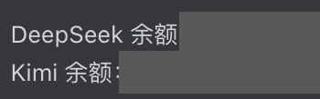
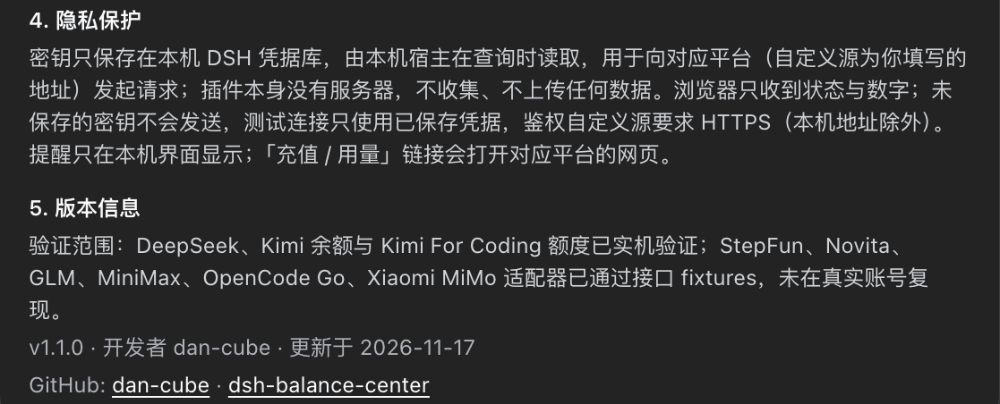

<div align="center">
  
  <h1>DSH 模型余额与额度中心 · DSH Balance &amp; Quota Center</h1>
  <p><strong>DSH 多平台模型余额与订阅额度显示管理插件</strong></p>
  <p>
    <strong><a href="https://github.com/dan-cube/dsh-balance-center/releases/download/v1.1.0/dsh-balance-center-1.1.0.tgz">下载 v1.1.0 (.tgz)</a></strong> ·
    <a href="#安装">安装指南</a> ·
    <a href="#支持清单与接入方式">支持清单</a>
  </p>
  <p>中文 · <a href="README.en.md">English</a></p>
</div>

在 DSH 侧边栏同时查看多个模型平台的余额与订阅额度，在设置页统一管理显示、排序、语言与刷新。

支持 DeepSeek、Kimi、OpenRouter、StepFun、Novita，以及部分 one-api / new-api 中转站；也支持订阅额度（GLM Coding Plan、MiniMax Token Plan、Kimi For Coding）。还可以添加自己的 JSON 余额接口。自动识别已配置的模型连接，只展示能读取余额或额度的来源。

这是面向 DeepSeek Harness（DSH）的第三方社区插件。余额按平台或账号查询，同一账号下多个模型可能共用余额，不是每个模型各有一个钱包。

## 界面预览

### 多个平台，同一处查看

余额行常驻侧边栏底部、账号上方。每个平台一行，金额与币种一眼可见。



> 真实 DSH 界面，余额数值已遮挡。

### 独立设置页，按自己的习惯管理

打开「设置 → 余额与额度」，逐项选择要显示的来源，调整顺序和标签语言，也可设置刷新间隔、手动刷新或添加自定义余额源。



> 新版说明页的隐私与版本区。

## 主要功能

- **余额与额度一体：**同时显示各平台余额与订阅套餐额度，无需切换模型后再逐个查看。
- **余额 + 订阅额度：**余额以金额显示；套餐额度以「剩余 % · 重置时间」显示（GLM Coding Plan、MiniMax Token Plan、Kimi For Coding）。
- **不可读连接有说明：**无余额接口 / 未配置密钥 / 无订阅套餐 / 登录过期的连接会列在「检测到的其他连接」；密钥错误、网络失败等会留在「余额来源」列表并标注原因，不会静默消失。
- **自动识别模型连接：**在 DSH「设置 → 模型」中配置服务商后，重新打开本插件设置页即可触发识别。
- **统一显示名称：**中文使用「平台名 余额」，例如「DeepSeek 余额」「Kimi 余额」；可单独改为英文标签。
- **逐项显示与排序：**每个来源都有独立开关，可用 ↑ / ↓ 调整顺序。
- **灵活刷新：**支持 15 秒、30 秒、1 分钟、2 分钟、5 分钟或手动刷新；窗口重新聚焦、打开设置页时也会刷新。
- **自定义余额源：**配置 JSON 接口地址、鉴权方式、余额字段路径与币种；测试连接只使用已保存的密钥，未保存的密钥不会发送，先保存再测试；鉴权源要求 HTTPS（本机地址除外）。
- **中英文与主题适配：**页面语言可跟随 DSH，也可固定为中文或英文；使用 DSH 主题变量适配浅色与深色。
- **融入 DSH「模型」页：**每个服务商卡片直接显示余额 / 额度摘要，「模型」页底部还有汇总与刷新。
- **通用设置快捷开关：**可在「设置 → 通用设置」直接开启或关闭侧边栏显示，并配置低余额 / 低额度提醒。
- **充值入口：**已登录 DSH 账号时，设置页提供「充值 / 用量」快捷链接。
- **DSH 0.2.2 适配：**已在 DSH `0.2.2-rc.3` 实测；新增的 Models 卡片、通用设置、导航图标和悬浮提醒等接入点均已使用。

## 语言与显示

- **默认跟随系统**：插件语言默认与 DSH 应用语言一致（中文应用显示中文，英文应用显示英文）。
- **可以手动切换**：「设置 → 余额与额度 → 页面语言」可选「跟随应用 / 中文 / English」。
- **每个来源可单独设置标签语言**：来源行右侧的下拉可选「自动 / 中文 / EN」，只影响该行标签，金额与额度数字不变。
- 插件管理器的标题与描述、设置页全部文案、错误提示与状态说明、本 README 均提供中英文版本。

## 使用与设置

**主界面（侧边栏）**
- 侧边栏账号上方按你的排序显示各来源余额/额度，每行格式为 `平台名：金额` 或 `平台名：剩余 % · 重置时间`。
- 可在「设置 → 通用设置 → 在侧边栏显示余额与额度」一键隐藏或恢复（不影响设置页和「模型」页）。

**「设置 → 余额与额度」页面**
- 逐项显示/隐藏、↑↓ 排序、每个来源的标签语言；
- 「立即刷新」重新读取；刷新间隔可设为 15 秒 ~ 5 分钟或手动；
- 页面语言可跟随应用或固定中文/English；
- 已登录 DSH 账号时，页面顶部提供「充值 / 用量」快捷链接；
- 「添加自定义余额源」支持 JSON 接口 + 测试连接（只使用已保存的 Key）；
- 说明页（关于）列出支持清单、验证范围、版本/开发者/更新时间。

**「设置 → 模型」页**
- 每个已配置的模型服务商卡片内显示该来源的余额/额度摘要；
- 页面底部显示「余额与额度」汇总和刷新按钮。

**低余额 / 低额度提醒**
- 在「设置 → 通用设置」开启提醒，并设置余额阈值（¥5/10/20/50/100）与额度阈值（5/10/20/30%）；
- 触发时窗口右下角显示浮层，可关闭；提醒只在本机显示，不会上传。

## 支持清单与接入方式

**余额**是按量充值的账户金额；**额度**是订阅套餐的窗口用量（5 小时 / 周）。两者不是一回事，插件会分行显示——它既是余额中心，也是额度中心。

### 余额来源

| 来源 | 凭据 | 在哪里获取 | 显示 |
|---|---|---|---|
| DeepSeek（会员 / 账号登录） | 直接登录 DSH | DSH「设置 → 账号与余额」登录 | `DeepSeek 余额：¥xx` |
| DeepSeek 官方 API Key | API Key | DeepSeek 开放平台 `platform.deepseek.com` | 与账号登录合并为一行 |
| Kimi / Moonshot 开放平台 | API Key | `platform.moonshot.cn`（国际 `platform.moonshot.ai`） | `Kimi 余额：¥xx` / `$xx` |
| OpenRouter | 管理密钥或推理密钥 | `openrouter.ai` → Keys | 账户额度，或该 Key 的剩余额度 |
| StepFun 阶跃星辰 | API Key | `platform.stepfun.com` | `StepFun 余额：¥xx` |
| Novita AI | API Key | `novita.ai` → API Keys | `Novita 余额：$xx` |
| Xiaomi MiMo（按量） | API Key（`sk-`） | `platform.xiaomimimo.com` → API Key | `Xiaomi MiMo 余额：¥xx`（只请求官方 HTTPS 地址） |
| one-api / new-api 中转站 | API Key | 你的中转站后台 | 余额或额度 |
| 自定义 JSON 来源 | 任意（或不鉴权） | 你自己的 JSON 接口 | 自定义字段 + 币种 |

### 订阅额度来源

| 来源 | 凭据 | 在哪里获取 | 显示 |
|---|---|---|---|
| GLM Coding Plan（Z.ai / 智谱） | Coding Plan 的 API Key | 订阅后在 `z.ai` / `bigmodel.cn` 控制台创建 | `GLM Coding 额度：剩余 56% · 2h31m`，含 5h / 周 / 工具额度与套餐等级 |
| MiniMax Token Plan | API Key | `platform.minimaxi.com`（国际 `platform.minimax.io`） | `MiniMax 额度：剩余 75% · …` |
| Kimi For Coding（Kimi Code 会员） | 会员 API Key | 订阅后在 [Kimi Code 控制台](https://www.kimi.com/code/console) 创建（最多 5 个，只显示一次） | `Kimi Coding 额度：剩余 100% · …`，含 5h / 周窗口 |
| OpenCode Go | API Key | OpenCode Console / `OPENCODE_GO_API_KEY` | `OpenCode Go 额度：剩余 48% · …`，含 5h 滚动 / 周 / 月窗口 |
| Xiaomi MiMo Token Plan | Token Plan API Key（`tp-`） | `platform.xiaomimimo.com` → Token Plan | `Xiaomi MiMo 额度：剩余 85% · …`（CN / AMS / SGP 三区，只请求官方 HTTPS 地址） |

### 接入方式

1. **余额类**：在 DSH「设置 → 模型」里添加服务商并填 API Key（DeepSeek 也可直接登录账号），插件自动识别；其他 JSON 接口用「添加自定义余额源」。
2. **订阅额度类**：先订阅套餐，再用「第三方模型提供商」添加 `zai` / `zai-coding-cn` / `minimax` / `minimax-cn` / `kimi-coding` / `opencode-go` / `xiaomi-token-plan-cn` / `xiaomi-token-plan-ams` / `xiaomi-token-plan-sgp`，填入会员 API Key 即可；插件读数不需要 OAuth，也不需要换成开放平台的按量 Key。
3. **没有余额接口的平台**（OpenAI、Anthropic、Gemini、通义/百炼、火山方舟、文心/千帆、混元、Groq、Together 等）只有用量/账单接口，插件不显示；如有自己的 JSON 接口可用自定义源。
4. **SiliconFlow / 硅基流动**：官方已于 2026-08-14 下线 `/user/info`（实测 HTTP 410），暂无法显示；等官方替代接口后恢复，自建或中转可用自定义源。

### 设置页状态说明

设置页会解释不可读连接的原因；其中「检测到的其他连接」只列出没有显示到侧边栏的项（无接口 / 无密钥 / 无套餐 / 登录过期），密钥错误与网络失败会留在「余额来源」列表内并标注原因：

| 状态 | 含义 |
|---|---|
| 未配置密钥 | 连接已添加但还没填 Key |
| 无订阅套餐 | 该账户不是对应套餐（额度接口特有） |
| 订阅登录已过期 | Kimi Code 会员凭据失效，重新创建会员 Key |
| 官方余额接口已下线（HTTP 410） | 平台下线了余额接口（目前是 SiliconFlow） |
| 密钥无效 / 读取失败 | Key 错误、权限不足或网络问题 |

官方 DeepSeek 连接默认归并显示，减少同一账号的重复余额行；归并展示一个可读取连接，不累加金额，也不证明这些连接属于同一账号。使用多个 DeepSeek 账号时可开启「分开展示 DeepSeek 的多个连接」。

插件只列出实际能读取的来源。某个来源未出现，不代表模型无法调用；也可能是接口、权限或凭据暂不满足条件。

订阅额度不是金额：只有对应套餐账号才能读取，普通充值账户会显示「无订阅套餐」。额度行优先展示 5 小时池，其次周池，格式为「剩余 % · 重置时间」。

## 验证范围

- **已实机验证**（本机 DSH `0.2.2-rc.3`）：DeepSeek 余额、Kimi / Moonshot 余额、Kimi For Coding 额度、侧边栏行、设置页、显示/隐藏与排序、中英文切换、SiliconFlow HTTP 410 状态说明；「模型」页余额卡片/汇总、通用设置开关、导航图标、低余额提醒、充值/用量链接。
- **接口 fixtures 验证**：StepFun、Novita、GLM Coding Plan、MiniMax Token Plan、OpenCode Go、Xiaomi MiMo（余额与 Token Plan）的请求地址 / 鉴权头 / 解析；Kimi 同时返回短周期与周额度；上游错误文本脱敏；自定义源「测试连接」不写入已有凭据。
- **未验证**：StepFun、Novita、GLM、MiniMax、OpenCode Go、Xiaomi MiMo 未在真实账号复现（仅接口 fixtures）；DSH 0.3.x 未测试；SiliconFlow 替代接口尚未发布。

开发自检：`node tools/check.mjs --strict`。

## 安装

[GitHub Release v1.1.0](https://github.com/dan-cube/dsh-balance-center/releases/tag/v1.1.0) · [下载 .tgz](https://github.com/dan-cube/dsh-balance-center/releases/download/v1.1.0/dsh-balance-center-1.1.0.tgz)

### 通过 DSH 插件页面

1. 打开 DSH 侧边栏的「插件」页面，点击「添加插件」。
2. 输入 `git+https://github.com/dan-cube/dsh-balance-center.git#v1.1.0`。也可下载 Release 中的 `.tgz`，再填入该文件的本机绝对路径。按提示安装并启用。
3. 首次安装后重启一次 DSH，打开「设置 → 余额与额度」。

### 通过命令行

```sh
# DSH 桌面版
dsh plugin --profile desktop add 'git+https://github.com/dan-cube/dsh-balance-center.git#v1.1.0'

# DSH Web 版
dsh plugin --profile web add 'git+https://github.com/dan-cube/dsh-balance-center.git#v1.1.0'

# 从已下载的安装包安装，将路径换为文件的实际位置
dsh plugin --profile desktop add /absolute/path/to/dsh-balance-center-1.1.0.tgz
```

桌面版请使用桌面应用安装的 `dsh` 命令。如使用自定义 profile，请替换 `desktop` 或 `web`。

## 开始使用

1. **接入模型平台：**在 DSH「设置 → 模型」中配置要使用的服务商和 API。
2. **选择显示来源：**打开「设置 → 余额与额度」，开启希望常驻侧边栏的项目。
3. **调整显示习惯：**设置顺序、每项标签语言和刷新间隔。
4. **接入自己的接口：**点击「添加自定义余额源」，填写 GET 接口与 JSON 字段路径，测试成功后保存。

## 常见问题

### 为什么 DeepSeek 登录和多个 API 连接只显示一行？

插件默认将 DeepSeek 官方连接归并显示，以减少同一账号的重复余额行。归并时展示一个可读取连接的余额，不累加金额。若你使用多个不同的 DeepSeek 账号，请开启「分开展示 DeepSeek 的多个连接」。

默认归并属于显示策略，并不表示插件已经验证这些连接一定属于同一个账号。

### 为什么 OpenRouter 数字与账户页面不同？

账户总额度需要具有相应权限的管理密钥；普通推理密钥查询到的可能是该密钥的剩余限额。插件会标注当前查询口径。

### 为什么不是所有模型平台都会出现？

插件只列出能够读取余额或额度的来源。请先检查模型连接、余额接口权限与网络状态；如平台提供自己的 JSON 余额接口，可尝试添加自定义来源。

### 为什么硅基流动不显示？

硅基流动官方已下线 `/user/info` 余额接口（2026-08-14 停止服务，实测返回 HTTP 410），目前没有公开替代接口。插件会把该连接列在设置页并标注原因；等官方提供替代 API 后会重新支持。

### 订阅额度怎么显示？为什么显示「无订阅套餐」？

GLM Coding Plan、MiniMax Token Plan、Kimi For Coding 属于订阅套餐额度，不是充值余额。只有对应套餐账号才能读取，普通充值账户会显示「无订阅套餐」。Kimi For Coding 使用 Kimi Code 会员 API Key（或 DSH 登录态），凭据失效时显示「订阅登录已过期」。

### 设置页里的「检测到的其他连接」是什么？

这里列出已经接入 DSH、但当前无法显示到侧边栏的连接（无余额接口、未配置密钥、无订阅套餐、登录过期等）。密钥错误、网络失败等其他失败会留在「余额来源」列表中并标注原因；接入凭据或接口恢复后会自动变为可显示来源。

### 偏好和密钥保存在什么位置？

显示偏好保存在浏览器本地存储。已有模型连接的密钥由 DSH 宿主进程解析；自定义来源的密钥通过设置页输入，经 DSH 凭据服务保存，余额查询由宿主发起。

## 兼容性

交接记录中的本地验证版本为 `DSH 0.2.1-rc.5`。当前声明兼容范围为 `>=0.2.1-rc.5 <0.3.0-0`，不代表范围内每一个版本都已逐一实测；暂未声明支持 DSH 0.3.x。

## 卸载与升级

从 1.0.0 升级时，在 DSH「插件」页卸载旧版并按上面的步骤安装 1.1.0，然后重启 DSH。在「设置 → 余额与额度 → 说明」确认版本。同一 profile 中的显示偏好通常会保留，清空浏览器站点数据会重置这些偏好。

## 隐私说明

简单说：**插件本身没有服务器，不收集、不上传任何数据；Key 基本不会离开本机。**

- Key 保存在 DSH 本机凭据库（与 DSH 保存模型 Key 的方式一致），仅在查询余额/额度时由本机宿主进程读取；
- 读取后只用于向**对应平台官方接口**、或你为自定义源填写的地址发起请求；这是查询余额所必需的最小交互；
- 浏览器端只能拿到状态、金额/百分比和重置时间；**未保存的 Key 不会发送**，测试连接只使用已保存的凭据；
- 鉴权自定义源要求 HTTPS（本机回环地址除外），避免 Key 走明文；
- 无遥测、无统计、无第三方上报；插件本身不保留数据（显示偏好存在浏览器本地，Key 在 DSH 凭据库，可在 DSH 中删除）。

截图取自真实 DSH 界面，已裁剪或遮挡隐私信息。反馈问题时，请遮挡 API Key、账号信息、真实余额、私人会话和本机路径。

欢迎通过 [Issues](https://github.com/dan-cube/dsh-balance-center/issues) 反馈问题或提出建议。

## 开发检查

```sh
node tools/check.mjs --strict
```

## 许可证

[MIT](LICENSE) · 维护者：dan-cube · 版本 1.1.0 · 更新于 2026-11-17
